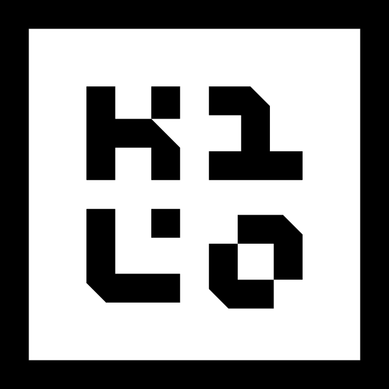
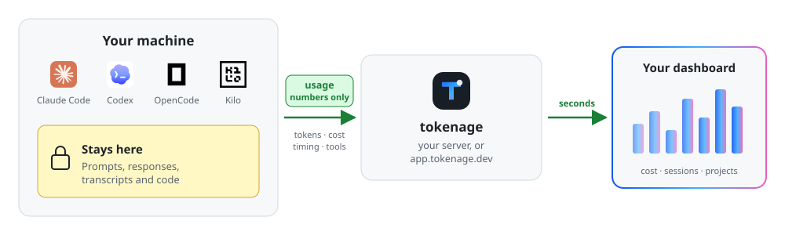

<div align="center">

<p></p>
<p></p>

### Every token your coding agents spend, in one dashboard.

Real-time, privacy-first usage and cost tracking for your coding agents.

[](https://github.com/Haannbboo/tokenage/tags)
[](https://github.com/Haannbboo/tokenage/tags)
[](https://github.com/Haannbboo/tokenage/actions/workflows/ci.yml)

<a href="https://tokenage.dev/demo/" target="_blank">
  <picture>
    <source media="(prefers-color-scheme: dark)" srcset="https://cdn.jsdelivr.net/gh/Haannbboo/tokenage@main/docs/assets/screenshots/overview-dark.jpg">
    
  </picture>
</a>

<sub>Click to open the live demo, no sign-in.</sub>


**Works with**

 Claude Code &nbsp;&nbsp;
 Codex &nbsp;&nbsp;
<picture><source media="(prefers-color-scheme: dark)" srcset="frontend/public/models/opencode-dark.png"></picture> OpenCode &nbsp;&nbsp;
<picture><source media="(prefers-color-scheme: dark)" srcset="frontend/public/models/kilocode-dark.png"></picture> Kilo

</div>


## Quick start

```sh
curl -fsSL https://app.tokenage.dev/install.sh | sh
```

Dashboard: https://app.tokenage.dev/

## What you get

<a href="https://cdn.jsdelivr.net/gh/Haannbboo/tokenage@main/docs/assets/screenshots/sessions-light.jpg" target="_blank">
  <picture>
    <source media="(prefers-color-scheme: dark)" srcset="https://cdn.jsdelivr.net/gh/Haannbboo/tokenage@main/docs/assets/screenshots/sessions-dark.jpg">
    
  </picture>
</a>

**Sessions.** Every agent session with its cost, tools and live status, plus how many ran in parallel.

<table>
  <tr>
    <td width="50%" valign="top">
      <a href="https://cdn.jsdelivr.net/gh/Haannbboo/tokenage@main/docs/assets/screenshots/logs-light.jpg" target="_blank">
        <picture>
          <source media="(prefers-color-scheme: dark)" srcset="https://cdn.jsdelivr.net/gh/Haannbboo/tokenage@main/docs/assets/screenshots/logs-dark.jpg">
          
        </picture>
      </a>
      <br><b>Request logs.</b> Each request with model, tokens, cache, latency and reasoning effort.
    </td>
    <td width="50%" valign="top">
      <a href="https://cdn.jsdelivr.net/gh/Haannbboo/tokenage@main/docs/assets/screenshots/projects-light.jpg" target="_blank">
        <picture>
          <source media="(prefers-color-scheme: dark)" srcset="https://cdn.jsdelivr.net/gh/Haannbboo/tokenage@main/docs/assets/screenshots/projects-dark.jpg">
          
        </picture>
      </a>
      <br><b>Projects.</b> Spend per repository, across every agent and device.
    </td>
  </tr>
</table>

## Supported agents and what's tracked

| | Claude Code | Codex | OpenCode | Kilo |
|---|:---:|:---:|:---:|:---:|
| Input, output tokens and cost | ✅ | ✅ | ✅ | ✅ |
| Cache reads | ✅ | ✅ | ✅ | ✅ |
| Cache writes | ✅ | ➖ | ✅ | ✅ |
| Reasoning tokens | ➖ | ✅ | ✅ | ✅ |
| Reasoning effort | ✅ | ✅ | ✅ | ✅ |
| Latency and time to first token | ✅ | ✅ | ✅ | ✅ |
| Sessions and projects | ✅ | ✅ | ✅ | ✅ |
| Tool calls and duration | ✅ | ✅ | ✅ | ✅ |
| Failed requests | ➖ | ➖ | ✅ | ✅ |
| Real-time updates | ✅ | ✅ | ✅ | ✅ |
| **🔒 Prompts, responses, transcripts, code** | | **Never leave your machine** | | |

<sub>➖ The agent doesn't report it. Captured through each agent's built-in OpenTelemetry export (Claude Code, Codex) or the tokenage plugin (OpenCode, Kilo); `tokenage login` sets it up.</sub>

<sub>🔒 Holds as long as the agents' own content logging (prompt or response text) stays off, which is their default and what `tokenage login` expects. If you've turned it on yourself (for example `OTEL_LOG_USER_PROMPTS` or response logging in Claude Code, `log_user_prompt` in Codex), the agent sends that text too; tokenage drops it on arrival and never stores it, but turn it off to keep it on your machine.</sub>

## How it works

<picture>
  <source media="(prefers-color-scheme: dark)" srcset="docs/assets/how-it-works-dark.svg">
  
</picture>

1. **Your agents report usage.** `tokenage login` turns on each agent's usage reporting. Content logging stays off.
2. **Only numbers travel.** Tokens, cost, timing and tool names go to your tokenage server. Prompts, responses and code don't.
3. **The dashboard updates live.** Each request shows up within seconds, by session, project, model and device.

## Self-host

| Setup | Command |
|---|---|
| One machine (server + client) | `curl -fsSL https://raw.githubusercontent.com/Haannbboo/tokenage/main/install.sh \| sh`, then pick **Both** |
| Docker, SQLite | `docker compose up -d` |
| Docker, bundled Postgres | Uncomment the bundled `db.url` in `config.yaml`, then `docker compose --profile postgres up -d` |

The Docker setups run from a checkout with a config file:

```sh
git clone https://github.com/Haannbboo/tokenage && cd tokenage/docker
cp ../src/config/config.example.yaml config.yaml
```

Config, TLS and scaling out: [docker/README.md](docker/README.md).

## Usage

```sh
# See what's tracked on this machine and whether the server is reachable
tokenage status

# Sign in again, or change which agents are tracked
tokenage login

# Update the client to the latest release
tokenage update

# Everything else
tokenage --help
```

## Development
<details>
<summary><b>Development setup</b></summary>

```sh
git clone https://github.com/Haannbboo/tokenage && cd tokenage
uv venv --python 3.13
uv pip install -r src/pyproject.toml --extra dev
npm ci --prefix frontend

# Run an isolated server with auto-reload on free ports
src/scripts/dev/dev-start.sh

# Tests
uv run python -m pytest -q
cd frontend && npm test
```

</details>
